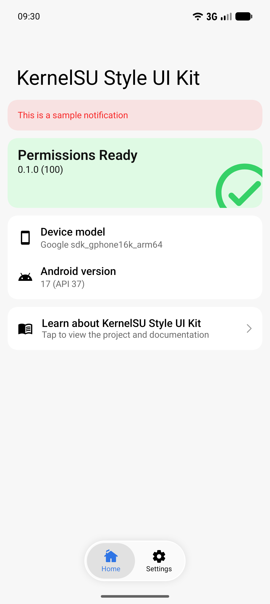
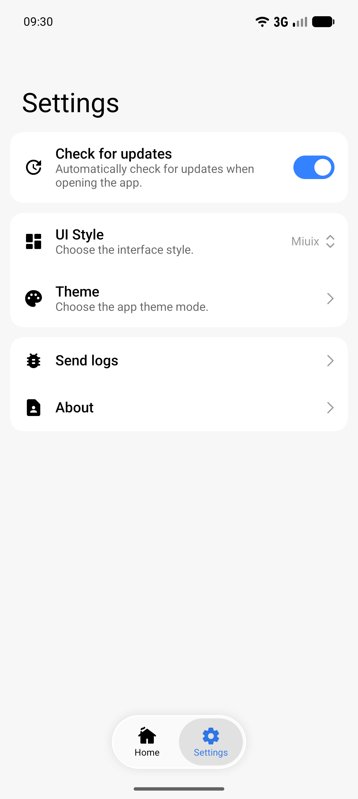
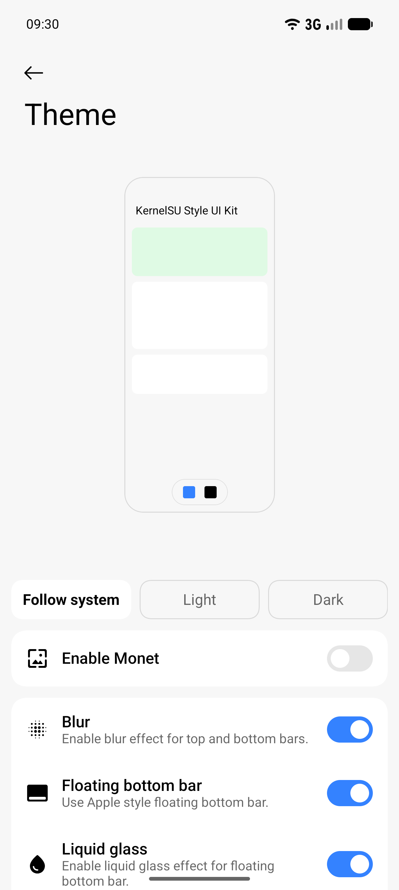

English | [简体中文](README.zh-CN.md)

# Remote Broadcast

Sends text to a classroom announcement server from a phone, with a one-tap look at the classroom
camera. The interface follows the Miuix layout of KernelSU Manager.

## Features

- Miuix interface with light, dark, and dynamic colors.
- Broadcast screen: type a message, pick the repeat count, send after a tap, a confirmation, or a long press.
- Classroom frame capture with pinch zoom.
- Home shows whether the server is online, with a detail page to re-check it.
- GitHub release checking and log sharing.
- Language: Simplified Chinese (follows the system).

## Screenshots

| Home | Settings | Theme settings |
| --- | --- | --- |
|  |  |  |

Screenshots still show the template screens; broadcast screenshots are to be added.

## Getting Started

Clone the repository and open it in Android Studio, or build from the command line:

```bash
git clone https://github.com/chenaizhang/KernelSU-Style-UI-Kit.git
cd KernelSU-Style-UI-Kit
./gradlew :app:assembleDebug
```

Requires JDK 21, Android SDK 37, and an Android 12 or newer device or emulator.

See the [Getting Started guide](GETTING_STARTED.md) for project setup, customization, testing, and release signing. See [Translations](../translations/README.md#english) to add another language.

## Discussion

Use [GitHub Issues](https://github.com/chenaizhang/KernelSU-Style-UI-Kit/issues) for bug reports, feature requests, and usage questions. For bugs, include the device and Android version, UI style, reproduction steps, and relevant screenshots or logs.

Contributions are welcome through [pull requests](https://github.com/chenaizhang/KernelSU-Style-UI-Kit/pulls).

## License

Licensed under the GNU General Public License v3.0. See [LICENSE](../LICENSE).

## Acknowledgements

- [KernelSU](https://github.com/tiann/KernelSU) for the Manager UI foundation.
- [Miuix](https://github.com/compose-miuix-ui/miuix) for its Compose components.
- [Jetpack Compose](https://developer.android.com/compose) and [Material Design](https://m3.material.io/) for the Android UI ecosystem.
