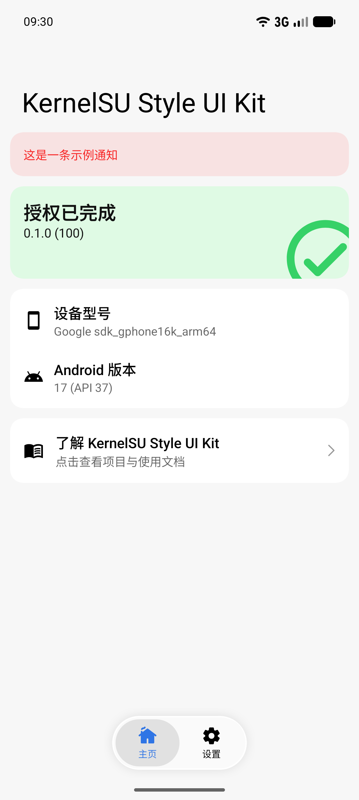
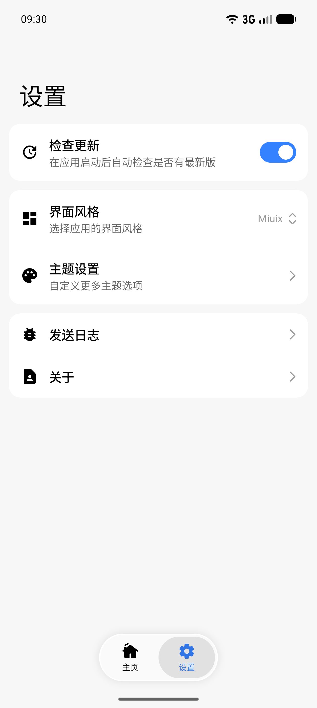
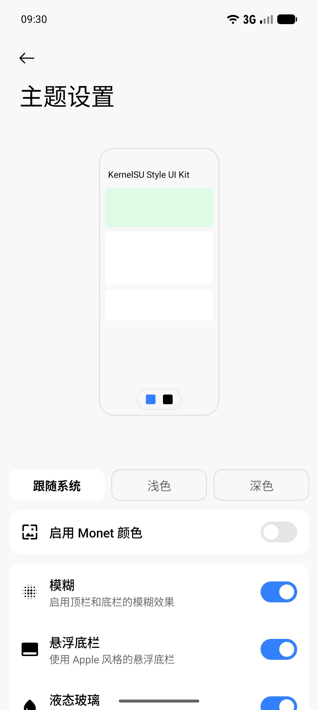

[English](README.md) | 简体中文

# 远程喊话

在手机上往教室的播报服务发文字，顺便看一眼教室画面。界面取自 KernelSU Manager 的 Miuix 布局。

## 功能

- Miuix 界面，支持浅色、深色与动态配色。
- 喊话页：输入内容、选择遍数、长按或确认后发送。
- 教室取帧：单帧查看，支持双指缩放。
- 首页显示服务器在线状态，详情页可重新检测。
- 基于 GitHub Releases 的更新检查与日志分享。
- 语言：简体中文（跟随系统）。

## 截图

| 首页 | 设置 | 主题设置 |
| --- | --- | --- |
|  |  |  |

截图沿用模板界面，喊话页截图待补。

## 快速开始

克隆后用 Android Studio 打开，或直接命令行构建：

```bash
git clone https://github.com/chenaizhang/KernelSU-Style-UI-Kit.git
cd KernelSU-Style-UI-Kit
./gradlew :app:assembleDebug
```

需要 JDK 21、Android SDK 37，以及 Android 12 或更高版本的设备或模拟器。

项目配置、自定义、测试与发布签名见[上手指南](GETTING_STARTED.zh-CN.md)；新增语言见[翻译指南](../translations/README.md#简体中文)。

## 讨论

问题反馈、功能建议和使用讨论请提交到 [GitHub Issues](https://github.com/chenaizhang/KernelSU-Style-UI-Kit/issues)。反馈问题时，请附上设备与 Android 版本、界面风格、复现步骤，以及相关截图或日志。

欢迎通过 [Pull Request](https://github.com/chenaizhang/KernelSU-Style-UI-Kit/pulls) 参与贡献。

## 许可证

本项目采用 GNU General Public License v3.0，详见 [LICENSE](../LICENSE)。

## 致谢

- [KernelSU](https://github.com/tiann/KernelSU)：提供 Manager 界面基础。
- [Miuix](https://github.com/compose-miuix-ui/miuix)：提供 Compose 组件。
- [Jetpack Compose](https://developer.android.com/compose) 与 [Material Design](https://m3.material.io/)：提供 Android UI 生态支持。
